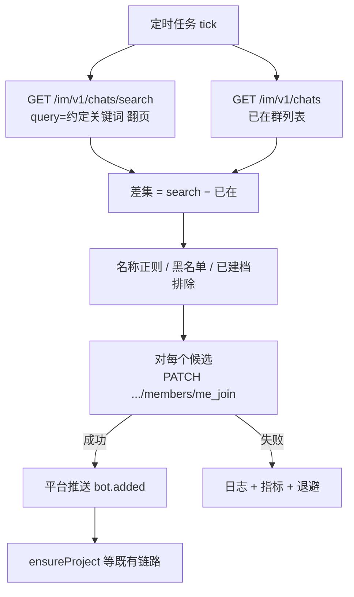

# 飞书公开群：search + me_join 自动入群（路径 C）—— 技术方案

用户在飞书客户端自建公开课题群、未必手动拉机器人时，用定时轮询发现「对项目助手可见但尚未加入」的公开群，再 `me_join` 自愿入群；入群后仍走既有 `im.chat.member.bot.added_v1` → `ensureProject`。  
本文是《飞书公开群自动入群-技术方案》中的**路径 C** 独立展开；不替代人拉 bot（路径 A），也不要求用户进业务系统建群（路径 B）。

依据飞书开放平台公开文档核对。

---

## 1. 要解决什么

| 痛点 | 本路径做法 |
| --- | --- |
| 无「群创建」可订阅事件 | 不监听建群；轮询**已存在且对 bot 可见**的公开群 |
| 忘了拉机器人导致漏档 | 差集后自动 `me_join`，补进群 |
| 不想为建群单独进 Web | 用户仍只在飞书客户端建公开群 |

**本路径只负责：发现候选群 → 机器人入群。**  
建档、成员 ACL、采集、群内说明卡片：入群成功后由 `bot.added` 与 `domain/` 处理，与路径 A 相同。

---

## 2. 硬性前提

全部满足才可启用；任一不满足则本路径无效或危险。

| 条件 | 要求 | 不满足时 |
| --- | --- | --- |
| 群类型 | `chat_type = public` | `me_join` 仅支持公开群；私有群搜不到或入不了 |
| 命名 | 名称含**稳定非空关键词/前缀**（如「课题」） | search **空关键词返回空列表**，无法扫群 |
| 入群审批 | `membership_approval` 为无需审批 | 开启则 `me_join` 失败，错误码 `232075` |
| 应用 | 自建应用 + 机器人能力；具备搜群/读群/`me_join` 权限 | 调不通接口 |
| 租户 | 操作方与群同租户（内部群） | 跨租户失败 |
| 过滤规则 | 关键词 + 群名 allow 正则等，控制误入面 | 可能误入行政/活动等其它公开群 |

「对机器人公开」= 飞书群类型 **公开群**，不是「应用可用范围覆盖全员」就能看见私有群。

---

## 3. 流程

### 3.1 单轮步骤

1. 按 `intervalSec` 触发一轮（建议 1～5 分钟，可配）。
2. **Search**：`GET /open-apis/im/v1/chats/search?query=<约定关键词>&page_size=100`，用 `page_token` 翻到 `has_more=false`。  
   - `query` **必填且非空**（官方：空或超 64 字符 → 空结果）。
3. **已在列表**：`GET /open-apis/im/v1/chats` 翻页，得到 bot 已加入的 `chat_id` 集合。
4. **差集**：search 命中 − 已在；再滤：
   - `nameAllowRegex`（建议必开）
   - 排除业务库已建档 `chat_id`（可选，避免对已退群故意不进的群反复 join）
   - 黑名单 `chat_id` / 名称
5. **入群**：对每个候选（受 `maxJoinsPerTick` 限制）：
   - 可选：`GET /im/v1/chats/:chat_id` 确认 `chat_type=public`
   - `PATCH /open-apis/im/v1/chats/:chat_id/members/me_join`
6. **成功**：等待 / 依赖 `im.chat.member.bot.added_v1` → `ensureProject` → 同步成员、扫历史、群内说明。  
   **失败**：记日志与指标，该 `chat_id` 退避，不拖垮整轮。

### 3.2 禁止写法

- **不要**对未入群调用 `POST .../chats/:chat_id/members`（`members.create`）把自己拉进群——官方要求操作者**已在群内**。
- **不要**用 `im.chat.member.user.added_v1` 当发现手段——bot 不在群就收不到。
- **不要**空关键词轮询 search。
- **不要**在轮询任务里直接改 `ProjectMember` 权威数据；入群后走事件 + 既有对账。

---

## 4. 接口与限流

| 接口 | 作用 | 限流（每应用每租户） |
| --- | --- | --- |
| `GET /im/v1/chats/search` | 搜可见群（所在群 + 对身份公开的群） | 1000/分 & 50/秒 |
| `GET /im/v1/chats` | 机器人已在群列表 | 1000/分 & 50/秒 |
| `GET /im/v1/chats/:chat_id` | 确认公开群等（可选） | 以该接口文档为准（群读类多为同级） |
| `PATCH .../members/me_join` | 自愿加入公开群 | 1000/分 & 50/秒 |

群组类接口官方说明**暂不支持提频**。超限：HTTP 429（部分旧接口可能 400），读响应头 `x-ogw-ratelimit-reset`（秒）后重试。

官方文档：

- [搜索可见群](https://open.feishu.cn/document/server-docs/group/chat/search)
- [所在群列表](https://open.feishu.cn/document/server-docs/group/chat/list)
- [自愿入群 me_join](https://open.feishu.cn/document/server-docs/group/chat-member/me_join)
- [频控策略](https://open.feishu.cn/document/server-docs/api-call-guide/frequency-control)

---

## 5. 错误与观测

| 错误码 / 情况 | 含义 | 处理 |
| --- | --- | --- |
| `232075` | 公开群开启入群验证，不能主动加入 | 告警；引导关审批或改走人拉 |
| `232008` | 群类型/模式不支持（非公开等） | 跳过；核对是否误入私有群 id |
| `232013` | 群人数已满 | 跳过并告警 |
| `232006` | 无效 `chat_id` | 跳过 |
| `232019` / HTTP 429 | 限流 | 按 `x-ogw-ratelimit-reset` 退避 |
| search 长期为空 | 关键词不对或没有匹配公开群 | 检查命名约定与 `query` 配置 |

建议指标：`auto_join_tick_total`、`search_hits`、`diff_size`、`me_join_ok`、`me_join_fail{code}`、`tick_duration_ms`。

---

## 6. 权限（本路径最小集）

| 能力 | 权限方向（以飞书文档「开启任一即可」为准） |
| --- | --- |
| search / 所在群列表 / 群信息 | `im:chat` 或 `im:chat:readonly` / `im:chat:read` 等 |
| `me_join` | `im:chat` 或 `im:chat.members:write_only` |

入群后的建档发卡另需消息发送、事件订阅（`im.chat.member.bot.added_v1` 等），见总册方案，不在本路径单独扩权说明。

---

## 7. 部署约束

- **单飞**：多实例时仅一个 worker 跑本任务（分布式锁或固定单副本），避免并发 `me_join`。
- **单轮上限**：`maxJoinsPerTick`，防止历史积压一次打满限流。
- **失败退避**：按 `chat_id` 指数退避或冷却表，避免死循环打同一失败群。
- **实现位置**：`research-collab-api` 进程内定时任务（与现有 cron 风格一致），调用同进程飞书 `Client`；入群后事件仍走长连接 `WSClient`。

---

## 8. 配置项

| 配置 | 说明 |
| --- | --- |
| `feishu.projectBot.autoJoin.enabled` | 是否启用本路径 |
| `feishu.projectBot.autoJoin.query` | search 关键词；启用时**必填** |
| `feishu.projectBot.autoJoin.nameAllowRegex` | 群名二次过滤；强烈建议配置 |
| `feishu.projectBot.autoJoin.intervalSec` | 轮询间隔 |
| `feishu.projectBot.autoJoin.maxJoinsPerTick` | 单轮最多 `me_join` 次数 |
| `feishu.projectBot.autoJoin.chatIdDenyList` | 可选黑名单 |

---

## 9. 验收标准

1. 公开群 + 名称命中 `query`/allow 规则 + 关闭入群审批：未手动拉 bot 时，在不超过一轮（或配置间隔内）完成 `me_join`，并出现 `bot.added` 建档与群内说明。  
2. 私有群：本路径不入群。  
3. 公开群开启入群审批：失败可观测（`232075`），任务不崩溃。  
4. `query` 过宽时，靠 `nameAllowRegex` 限制误入；无 allow 规则时不得默认「凡 search 到就 join」。  
5. `enabled=false` 时无 search/me_join 调用；人拉 bot 建档不受影响。

---

## 10. 与总册的关系

| 文档 | 关系 |
| --- | --- |
| `飞书公开群自动入群-技术方案.md` | 总览 A/B/C；路径 C 细节以**本文**为准 |
| `飞书与ZITADEL人物权限适配-技术方案.md` §5.1 | 建档入口仍是 `bot.added`；本路径不改 Person / ACL |
| `科研协作与管理智能体-技术方案.md` §11.3 | 公开群兜底补充；私有群仍不走自拉 |

---

## 11. 参考链接

- [搜索对用户或机器人可见的群列表](https://open.feishu.cn/document/server-docs/group/chat/search)
- [获取用户或机器人所在的群列表](https://open.feishu.cn/document/server-docs/group/chat/list)
- [用户或机器人主动加入群聊](https://open.feishu.cn/document/server-docs/group/chat-member/me_join)
- [将用户或机器人拉入群聊](https://open.feishu.cn/document/server-docs/group/chat-member/create)（本路径不用其自拉）
- [频控策略](https://open.feishu.cn/document/server-docs/api-call-guide/frequency-control)
- [事件列表](https://open.feishu.cn/document/server-docs/event-subscription-guide/event-list)
